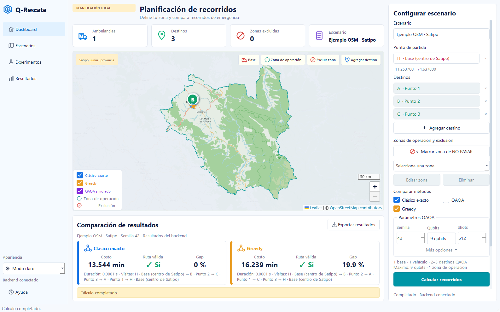

# Q-Route | Optimización híbrida de rutas para emergencias

**Categoría:** Algoritmos y aplicaciones  
**Reto:** Optimización de rutas y conexiones mediante algoritmos cuánticos.

> **¿Qué ocurre cuando una emergencia crece, una carretera se bloquea y las decisiones deben tomarse con recursos limitados?**  
> Q-Route convierte esa pregunta en un experimento reproducible de optimización clásica y cuántica con **IBM Qiskit**.

**Q-Rescate** es nuestro primer caso de estudio: una aplicación de escritorio para Windows que permite definir una base, destinos y zonas de exclusión sobre un mapa de **OpenStreetMap**, calcular recorridos y comparar enfoques de optimización.

**Qiskit Fall Fest 2026 · Categoría: Algoritmos y aplicaciones**



## ¿Por qué importa en el Perú?

Las emergencias no se limitan a encontrar una ruta corta. Cuando se afectan puentes y carreteras, aumentan los destinos o escasean los vehículos, la coordinación se vuelve un problema de decisiones combinatorias.

- **Fenómeno El Niño Costero (2017):** provocó inundaciones, huaicos e interrupciones de vías; un [informe de INDECI](https://bvpad.indeci.gob.pe/doc/pdf/esp/doc2678/doc2678-contenido.pdf) registra más de **1,4 millones de personas afectadas** a nivel nacional.
- **Lluvias e inundaciones (2023):** el [SENAMHI](https://www.gob.pe/institucion/senamhi/informes-publicaciones/4112500-boletin-climatico-nacional-marzo-2023) documentó precipitaciones intensas asociadas con el ciclón Yaku y las condiciones de El Niño Costero.
- **Incendios forestales en Satipo (octubre de 2026):** [Agencia Andina](https://andina.pe/agencia/noticia-incendio-forestal-junin-tras-19-dias-intensa-lucha-extinguen-siniestro-rio-tambo-1097047.aspx) informó que controlar el incendio de Río Tambo requirió **19 días** de trabajo conjunto de brigadistas, bomberos, Ejército y comunidades locales.

Estos hechos **motivan la investigación**, pero **no son datos operativos usados para calcular las rutas** ni pruebas de que Q-Rescate haya intervenido en esas emergencias.

### El desafío aumenta con la escala

Una sola unidad que debe visitar **3 destinos** puede hacerlo en **6 órdenes**; con **10 destinos**, los órdenes posibles ascienden a **3.628.800**. Esta cuenta ilustra el crecimiento combinatorio, **no significa que un algoritmo clásico eficiente deba enumerar todas las opciones**.

Nuestra pregunta de investigación es: **¿cómo cambian la calidad y el tiempo de las soluciones clásicas y cuánticas a medida que aumentan los destinos, las restricciones y los recursos?**

## ¿Qué construimos?

La versión integrada de **Q-Rescate** incluye:

- Interfaz nativa de **Windows con PySide6**, modos claro y oscuro.
- Mapa interactivo **Leaflet/OpenStreetMap**, con selección de base, destinos, zonas de operación y exclusiones.
- Obtención de vías transitables mediante **OSMnx**, con sentidos de circulación, tiempos estimados y almacenamiento en caché.
- Cálculo de rutas sobre el **mismo escenario** con un método clásico exacto, una heurística voraz (*greedy*) y **QAOA simulado con IBM Qiskit**.
- Visualización de geometrías, orden de visitas, costo estimado, validez, diferencia respecto del óptimo (*gap*) y duración del cálculo.
- Ejecución del cálculo en un proceso separado con estado, cancelación y límites de tiempo, para mantener la interfaz disponible.

**Alcance validado del motor principal:** una base, **un vehículo** y hasta **tres destinos con QAOA (nueve qubits)**. Hay experimentos separados sobre asignación de varios recursos y escalabilidad, pero **no son una capacidad operativa de múltiples vehículos en esta aplicación**.

## Arquitectura: de calles a decisiones

```text
Base, destinos y zonas bloqueadas
                ↓
Grafo vial dirigido y ponderado (OSMnx + NetworkX)
                ↓
Caminos permitidos y matriz de costos (Dijkstra)
                ↓
      Problema de rutas TSP dirigido
                ↓
         Formulación QUBO
                ↓
     ┌──────────┴────────────┐
     ↓                       ↓
Métodos clásicos        QAOA con Qiskit
(exacto y greedy)       (simulación local)
     └──────────┬────────────┘
                ↓
  Comparación de rutas y resultados
```

El modelo principal resuelve un **TSP asimétrico con depósito fijo**: visita cada destino una vez y regresa a la base. La formulación QUBO utiliza variables binarias para representar la posición de cada destino en la secuencia. Para `n` destinos utiliza `n²` variables/qubits.

**Tecnologías:** Python, PySide6, Leaflet, OpenStreetMap, OSMnx, NetworkX, Dijkstra, QUBO, **Qiskit SDK**, **Qiskit Algorithms**, **Qiskit Optimization** y `StatevectorSampler`.

**Importante:** QAOA se ejecuta mediante un **simulador clásico de circuitos cuánticos**. **No hemos utilizado hardware cuántico físico de IBM ni demostrado una ventaja cuántica práctica.** Grover se investigó en un [experimento independiente](https://github.com/alejandrasalas-dev/q-rescate/pull/13), no como algoritmo central de la aplicación.

## Resultados verificables

### Recorridos sobre calles de OpenStreetMap (Satipo)

| Prueba | Método | Resultado |
| --- | --- | --- |
| Tres destinos sobre una red vial OSM | Clásico exacto | **13,544 min estimados** |
| Mismo escenario y misma matriz | Heurística voraz | **16,239 min estimados** |
| Dos destinos sobre una red vial OSM | Clásico exacto | **5,576 min estimados** |
| Mismo escenario de dos destinos | QAOA, 4 qubits | **5,576 min estimados** |

Las dos parejas de resultados corresponden a **escenarios distintos**; no deben mezclarse al calcular diferencias. Las duraciones son **estimaciones derivadas de velocidades y geometrías de OSMnx**, no tiempos de atención de emergencias reales. Los escenarios usan puntos ilustrativos.

### Investigación sobre grafos sintéticos

En un [benchmark reproducible de 12 ejecuciones](https://github.com/alejandrasalas-dev/q-rescate/pull/10), QAOA produjo **12/12 rutas válidas** y alcanzó el óptimo clásico en **11/12**. En algunos casos igualó el óptimo; en otros no. Frente a problemas pequeños, el solucionador clásico exacto fue más rápido.

La [validación de integración](integration-evidence/REPORT.md) documenta **152 pruebas aprobadas en una ejecución local de Windows** y casos con red OSM, exclusiones y cancelación. Existe además una [validación independiente de 53 pruebas en GitHub Actions para Windows](https://github.com/alejandrasalas-dev/q-rescate/actions/runs/40130602083). **Advertencia:** otra ejecución posterior del benchmark de QAOA en GitHub Actions superó su límite de cuatro minutos; no afirmamos que toda la CI esté aprobada.

Este prototipo es una **herramienta de investigación**, no un sistema validado de despacho de ambulancias o brigadas.

## Cómo ejecutar Q-Rescate en Windows

**Requisitos:** Windows de 64 bits, Python 3.13 recomendado e Internet para instalar dependencias y obtener mapas/calles cuando no estén en caché.

1. En GitHub, selecciona **Code → Download ZIP** y extrae **toda** la carpeta.
2. Ejecuta `INICIAR_Q_RESCATE.cmd` desde la raíz del proyecto y permite la instalación inicial de dependencias.
3. En la aplicación, selecciona una base, al menos dos destinos y, si lo deseas, una zona bloqueada. Ejecuta la comparación.

También puedes iniciarla manualmente desde PowerShell en la raíz del repositorio:

```powershell
python -m venv .venv
.\.venv\Scripts\python.exe -m pip install -r requirements-desktop.txt
.\.venv\Scripts\python.exe run_qrescate.py
```

> **Estado de distribución:** el inicio desde código está documentado y probado; **no hay garantía de que exista un `.exe` autónomo validado en otra PC**. No descargar únicamente la carpeta `desktop/`, porque necesita el motor y otros archivos de la raíz. Docker no es necesario.

Consulta la [guía técnica de instalación e integración](docs/desktop-integration.md) para parámetros, cobertura, fallos de servicios OSM y procedimientos de prueba.

## Código, evidencia y siguientes pasos

- [Aplicación e integración Windows](https://github.com/alejandrasalas-dev/q-rescate/pull/17) y [documentación de integración](docs/desktop-integration.md).
- [Informe de resultados sobre calles reales y pruebas](integration-evidence/REPORT.md).
- [Formulación matemática y validación QUBO](docs/math/qubo-validation.md).
- [Experimentos de fiabilidad QAOA](https://github.com/alejandrasalas-dev/q-rescate/pull/10).
- [Estudio exploratorio de mayor escala y múltiples recursos](https://github.com/alejandrasalas-dev/q-rescate/pull/12).

**Próximos retos:** comprobar ejecutables autónomos, ampliar pruebas sobre diferentes regiones y redes, modelar varios vehículos con capacidades y prioridades, y estudiar soluciones híbridas para instancias progresivamente mayores. **No presumimos que QAOA vaya a superar a la computación clásica: queremos medir bajo qué condiciones es competitivo.**

## Equipo

**Alejandra:** coordinación e integración · **Angelo:** formulación matemática y motor · **Carlos:** interfaz y pruebas · **Alexia:** investigación, narrativa y presentación.

---

*Proyecto académico experimental del Qiskit Fall Fest 2026. No ofrece predicciones de emergencia, rutas certificadas ni instrucciones operativas para situaciones de riesgo. Los hechos históricos se citan como motivación, no como resultados del sistema.*
